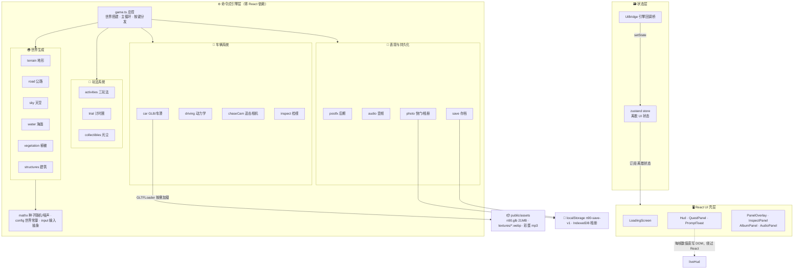

<div align="center">

# 🚗 N90 环岛之旅（n90-island）

**浏览器里的 3D 开放世界驾驶游戏 —— 程序化海岛 + 小米 N90 MAX，由 33.6MB 单文件页面工程化重建**

*Drive a procedurally generated island · Vite + React 18 + TypeScript + three.js*

[](https://www.typescriptlang.org/)
[](https://react.dev/)
[](https://threejs.org/)
[](https://vite.dev/)
[](https://github.com/pmndrs/zustand)

[快速开始](#-快速开始) · [操作按键](#-操作按键) · [架构总览](#️-架构总览) · [技术亮点](#-核心技术亮点) · [项目结构](#-项目结构) · [Roadmap](#️-roadmap)

</div>

---

## 📖 这是什么

在一座完全程序化生成的海岛上，驾驶一辆「小米 N90 MAX · 探索版」自由探索：环岛公路巡航、海岸钓鱼、营地休憩、山林越野、计时赛竞速，还可以随时按 `P` 把喜欢的画面拍进相册。

本项目由一个 33.6MB 的单文件 HTML 页面（代码与资产全部内嵌）**逆向重构**为标准 Vite 工程：命令式 three.js 引擎 + React UI 壳层双层架构，**1:1 复刻原版体验**——世界布局（固定种子）、驾驶手感、昼夜光照、玩法状态机、音频三轨与后期管线均与原版逐项对齐。资产外置后，JS 体积从 33.6MB 降到 888KB（gzip 247KB），贴图全部转为 WebP 按需加载。

> 💡 它也是一份 **three.js 开放世界工程化参考实现**：无物理引擎的车辆动力学、种子化确定性世界生成、每帧 HUD 数值旁路 React 的性能方案、全程序化的音频与贴图管线，都有清晰的模块落点。

## ✨ 功能全景

- 🏝️ **程序化海岛** — 513² 高度场 + 顶点配色网格，山脊噪声山脉 / 沙滩 / 草甸 / 岩石，布局由固定种子决定，跨设备完全一致
- 🚙 **自由驾驶** — 无物理引擎的车辆动力学：抓地力模型、手刹漂移、四轮俯仰侧倾、落水减速（`driving.ts`）
- 🔍 **检视模式** — 轨道相机环绕看车，点击车门可开合、切换 8 种车漆、后备箱与车顶帐篷展开（`inspect.ts` + `car.ts`）
- 🎣 **三种玩法** — 海边钓鱼（张力博弈）、营地休息（动作序列）、越野小径（检查点竞速）（`activities.ts`）
- ⏱️ **环岛计时赛** — 5 道蓝门 + 金色终点门跑完整圈，纪录最佳成绩随存档持久化（`trial.ts`）
- ✨ **光尘收集** — 12 枚种子化散布的发光体，细光柱远程可见，全收集触发专属任务（`collectibles.ts`）
- 📔 **任务手册** — 7 项任务统一由 `Activities.reward()` 收口，进度随 localStorage 持久化
- 📸 **快门与相册** — WebGL 帧捕获天然不含 UI 覆盖层；IndexedDB 持久存储，支持缩略图浏览、原图下载、分享海报合成（`photo.ts`）
- 🌅 **昼夜系统** — 天空穹顶 shader 五档时刻切换，太阳方位、雾色、海面反照随时间联动（`sky.ts` + `water.ts`）
- 🎵 **全程序化音频** — WebAudio 16 步音序器三轨 BGM、随速变调的引擎声、环境音床，外加一枚 MP3 彩蛋（`audio.ts`）
- 🌊 **氛围表现** — Bloom + 调色 / 暗角 / 颗粒 / 色差后期管线，顶点波浪海面带深度泡沫与菲涅尔反射（`postfx.ts` + `water.ts`）

## 🎮 操作按键

| 按键 | 功能 | 按键 | 功能 |
| --- | --- | --- | --- |
| `W A S D` / 方向键 | 驾驶 | `V` | 进入 / 退出检视模式 |
| `Space` | 手刹（漂移） | `T` | 切换昼夜时刻 |
| `E` | 交互（进入 / 退出玩法、信标、光门） | `J` | 任务手册 |
| `P` | 快门拍照 | `B` | 相册 |
| `R` | 传送回最近公路点（计时中禁用） | `M` | 音频设置面板 |
| `Esc` | 关闭面板 / 退出玩法 | `1 2 3` | 营地动作 |
| 鼠标拖拽 | 检视模式旋转视角 | 滚轮 | 检视模式缩放 |

## 🏗️ 架构总览

核心设计：**命令式引擎层与 React UI 壳层严格分离**。引擎层（`src/engine/`）零 React 依赖，`game.ts` 总控世界搭建、主循环与按键分发；React 只负责 HUD / 面板等 UI 渲染，通过 zustand 管理离散状态。**每帧高频数值（时速 / 罗盘 / 圈速）绕过 React 直写 DOM**，保证 60fps 下 HUD 刷新零重渲开销。



## 🔧 核心技术亮点

- 🎲 **种子化确定性世界生成** — `mathx.ts` 实现种子随机（CB 20261018）、值噪声、fbm 与山脊噪声，地形、植被散布、光尘位置全部由固定种子推导，任何设备加载结果逐点一致，且与原版布局对齐——这是 1:1 复刻的数学基础
- ⚡ **每帧数值旁路 React** — zustand 只承载离散 UI 状态（面板开关 / 玩法阶段），时速、罗盘、圈速等 60fps 数值经 `liveHud` 直写 DOM，避免整树重渲（`state/store.ts` + `ui/Hud.tsx`）
- 🌿 **实例化植被管线** — 9 种程序化几何体（松 / 云杉 / 橡 / 白桦 / 棕榈 / 灌木 / 蕨 / 草 / 岩）颜色抖动后合并，`InstancedMesh` 万级实例一次 draw call，顶点着色器实现风场摇曳（`vegetation.ts`）
- 🖌️ **Canvas 程序化贴图** — 车漆法线、地形反照率 / 法线、路面条纹全部运行时 Canvas 生成，零贴图资产依赖（`car.ts` / `terrain.ts` / `road.ts`）
- 🏎️ **无物理引擎车辆动力学** — 四轮独立采样地形高度驱动俯仰侧倾，前轮转向 + 差速油门 + 手刹漂移系数 + 落水拖曳，手感参数与原版逐项对齐（`driving.ts`）
- 🔊 **WebAudio 全合成音频** — 16 步音序器调度 kick / snare / hat / bass 三轨，振荡器 + 噪声缓冲合成，引擎声随速变调，首键交互即解锁 AudioContext（`audio.ts`）
- 💾 **双持久化轨道** — localStorage（`n90-save-v1`）承载任务日志 / 最佳圈速 / 车漆 / 昼夜档，结构向下兼容扩展；IndexedDB 承载相册原图（`save.ts` + `photo.ts`）

## 🚀 快速开始

### 0️⃣ 环境要求

| 组件 | 版本 | 说明 |
| --- | --- | --- |
| Node.js | ≥ 18.18（推荐 20+） | Vite 6 要求 |
| npm | ≥ 9 | 随 Node 附带 |
| 浏览器 | Chrome / Edge / Firefox 近两年版本 | WebGL2 + WebAudio |

### 1️⃣ 安装与启动

```bash
git clone <你的仓库地址>
cd n90-island
npm install          # 安装依赖
npm run dev          # 开发服务器 → http://localhost:5180
```

### 2️⃣ 构建与预览

```bash
npm run build        # tsc --noEmit 类型检查 + 产线构建 → dist/
npm run preview      # 本地预览构建产物
```

> `npm run optimize:textures` 是一次性贴图优化脚本（JPG→WebP，sharp），已执行过，无需重跑。

### 3️⃣ 体验核心链路

1. 加载完成后按任意键进入，开场环绕运镜结束即接管车辆
2. `W A S D` 沿环岛公路开一段，`T` 切到黄昏看海面反光
3. 看到路边信标时按 `E` 接入计时赛，跑完一圈查看最佳成绩
4. 靠近发光的细光柱收集光尘；开到码头 / 营地 / 小径起点按 `E` 进入钓鱼 / 休憩 / 越野
5. 随时 `P` 拍照、`B` 看相册并下载分享海报、`J` 查看任务进度（进度自动存档）

## 📁 项目结构

```
n90-island/
├── 📂 public/assets/        # 📦 模型 · 贴图 · 音频（按需加载）
│   ├── models/n90.glb       #   车辆模型 21MB
│   ├── textures/*.webp      #   内饰贴图（已 WebP 压缩）
│   └── audio/*.mp3          #   彩蛋音频
├── 📂 scripts/              # 🔧 工具脚本
│   └── optimize-textures.mjs    # 贴图 JPG→WebP 一次性转换（sharp）
├── 📂 src/
│   ├── 📂 engine/           # ⚙️ 命令式引擎层（零 React 依赖）
│   │   ├── game.ts          #   总控：世界搭建、主循环、按键分发、调试句柄
│   │   ├── mathx.ts         #   种子随机 / 值噪声 / fbm / 山脊噪声
│   │   ├── config.ts        #   世界常量、站点、越野折线、车漆、材质规则
│   │   ├── terrain.ts       #   513² 高度场 + 顶点配色 + 草地/岩石片元 patch
│   │   ├── road.ts          #   900 点环岛公路（路面/虚线/护栏/反光柱）
│   │   ├── sky.ts           #   天空穹顶 shader + 光照 + FogExp2 + 昼夜 setTime
│   │   ├── water.ts         #   海面：顶点波浪 + 深度/泡沫/菲涅尔
│   │   ├── vegetation.ts    #   9 种程序化植被 + 实例化散布 + 风场摇曳
│   │   ├── structures.ts    #   灯塔/码头/营地/村舍/石桥/信标/光门/海鸟
│   │   ├── car.ts           #   GLB 载入 + 材质归类 + 内饰贴图 + 开合动画
│   │   ├── driving.ts       #   车辆动力学（抓地/漂移/俯仰侧倾/落水）
│   │   ├── chaseCam.ts      #   追击相机 + 开场环绕运镜
│   │   ├── inspect.ts       #   检视轨道相机 + 点击拾取车门
│   │   ├── activities.ts    #   钓鱼/营地/越野状态机 + 统一奖励入口
│   │   ├── trial.ts         #   环岛计时赛（蓝门 + 金色终点门）
│   │   ├── collectibles.ts  #   光尘收集（种子化散布 + 拾取判定）
│   │   ├── photo.ts         #   快门帧捕获 + IndexedDB 相册 + 海报合成
│   │   ├── postfx.ts        #   Bloom + 调色/暗角/颗粒/色差 + OutputPass
│   │   ├── audio.ts         #   WebAudio 音序器三轨 + 引擎声 + 环境床
│   │   ├── input.ts         #   输入抽象（press/release API，为触屏预留）
│   │   ├── save.ts          #   localStorage 存档（n90-save-v1）
│   │   └── gameRef.ts       #   Game 全局引用
│   ├── 📂 state/            # 🗃️ zustand store + UiBridge 引擎回调桥
│   ├── 📂 ui/               # 🖥️ React 组件（Hud/面板/相册/加载屏等）
│   │   ├── Hud.tsx · QuestPanel.tsx · PromptToast.tsx
│   │   ├── PanelOverlay.tsx · InspectPanel.tsx · AudioPanel.tsx
│   │   ├── AlbumPanel.tsx · LoadingScreen.tsx · useRafRender.ts
│   └── 📂 styles/           # 🎨 全局样式（设计 token：--sand/--ink/--gold）
├── vite.config.ts           # base: "./"（支持静态托管子路径）
└── tsconfig.json            # strict 模式
```

## 🆚 与原版单文件的差异

均为有意为之：

1. **资产外置按需加载** — 33.6MB 单文件 → 888KB JS（gzip 247KB）+ 独立资产文件；贴图转 WebP
2. **存档系统（新增）** — `n90-save-v1` 持久化任务日志 / 最佳圈速 / 车漆 / 昼夜档；音量键沿用原版，两版互通
3. **统计脚本未带** — 原版的 Cloudflare 统计未随迁移，部署时按需自行加回
4. **保真原则** — 原版遗留的不可达 `cockpit` 相机分支按原样保留

保真验证：世界布局（固定种子）、驾驶手感参数、昼夜五档、检视 / 开门 / 车漆、三玩法状态机与文案、圈速与任务系统、音频三轨与彩蛋、后期管线、HUD（含原版浮点怪癖）均已逐项对齐，并经新旧并排截图比对确认地形轮廓、树簇分布、光照氛围一致。

<details>
<summary><b>🧭 扩展指南（二期 A–E 路线）</b>（点击展开）</summary>

- **A 更多玩法** — 在 `engine/activities.ts` 加一个 state 分支 + `ui/PanelOverlay.tsx` 加一个面板体组件；存档字段往 `save.ts` 的 journal 里加 id 即可。计时赛（`trial.ts`）是现成的第二例
- **D 任务 / 收集系统** — `Activities.reward()` 是统一完成入口，`QUEST_IDS` 加 id 即上新任务；journal 已落盘
- **E 截图 / 相册** — 快门 / 相册 / 海报已上线（`photo.ts`）；加滤镜或水印在 `composePoster` 里叠一层即可
- **B 更多地图 / C 更多车型** — 世界常量收敛在 `config.ts`（`WORLD/SITES/TRAIL`），车辆材质映射在 `CAR_MATERIAL_RULES`；换图 = 换一组常量，换车 = 换 GLB + 规则表
- **移动端** — `Input.press/release` 是唯一输入入口，接虚拟摇杆不需要动游戏逻辑

</details>

<details>
<summary><b>🛠️ 开发注意与调试参数</b>（点击展开）</summary>

**已知坑（本机实测）**

1. **后台标签页冻结 rAF** — 页面切后台时主循环暂停（浏览器标准行为），回前台自动恢复；自动化测试请保持标签页可见
2. **中文路径下 vite 文件监听偶尔失效** — 改动源码后表现陈旧时重启 `npm run dev`（必要时加 `--force` 清缓存）
3. **端口占用残留** — `netstat -ano | findstr :5180` 找 PID 后 `taskkill /F /PID <pid>`

**URL 调试参数**

| 参数 | 作用 |
| --- | --- |
| `?time=18.6` | 设定时刻（0–24） |
| `?skipintro` | 跳过开场运镜 |
| `?nofx` | 关闭后期管线 |
| `?ri=123` | 路点相机预览 |
| `?cx&cy&cz&tx&ty&tz` | 自由机位 |

**控制台调试句柄** — `window.__scene / __terrain / __road / __sky / __car / __driving / __game / __state()` 等（`K` 键重建环境）。

</details>

## 🗺️ Roadmap

- [x] 单文件 → Vite 工程化重建，1:1 复刻
- [x] 三玩法 + 计时赛 + 光尘收集 + 任务手册
- [x] 快门 / 相册 / 分享海报（IndexedDB 持久化）
- [x] 存档系统（localStorage，向下兼容扩展）
- [ ] 移动端触屏支持（虚拟摇杆接入 `Input` 抽象层）
- [ ] B 更多地图：换一组 `config.ts` 世界常量
- [ ] C 更多车型：换 GLB + 材质规则表
- [ ] 照片滤镜 / 水印（`composePoster` 扩展）

## 🙏 说明

本项目为粉丝向的还原与技术练手作品，与小米公司官方无关；「N90」及相关名称仅作描述性使用。欢迎 Issue / PR——Fork → 新建分支 → 提交 → 发起 Pull Request 即可。

如果这个项目对你有参考价值，欢迎点个 Star ⭐

<div align="center">

**用 three.js 造一座岛，用 React 管一面窗。**

</div>
